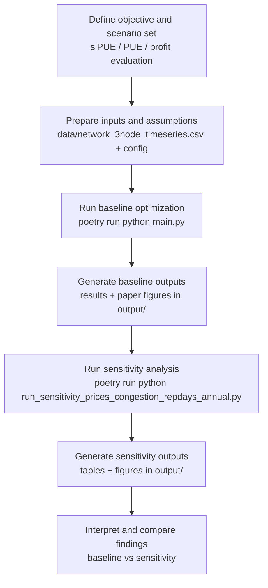

# sipue_modelling

Modeling code and experiment outputs for the paper:
**"Impact of Datacenter on Local Energy Systems - A business and economic perspective"**
by Sambeet Mishra, Ankana Singha, Khaled Aleikisha, Thomas Oyvang, Dominic Stephen, and Rob Hovsapianc.

## Overview

This repository implements a two-stage optimization framework for data center integration with local energy systems and evaluates **System-Integrated PUE (siPUE)** alongside conventional PUE and profit outcomes.

The core idea is to evaluate data centers not only as electricity loads, but as active system participants through:
- heat export to district heating,
- flexibility services,
- storage-enabled operation,
- and carbon/price exposure in dispatch decisions.

## What This Repo Contains

- `brave/`: core modeling package (config, scenario generation, optimization, metrics, plotting, exports).
- `main.py`: thin compatibility entrypoint that re-exports public APIs from `brave`.
- `run_sensitivity_prices_congestion_repdays_annual.py`: sensitivity-analysis runner.
- `data/network_3node_timeseries.csv`: network and time-series input data.
- `output/`: generated results tables and paper figures.
- `tests/`: unit and integration-style tests plus golden references.

## Model outline

From the referenced paper's abstract and setup:
- siPUE is defined to recover conventional PUE when no external services are provided.
- Service credits (heat/flexibility) and carbon exposure are integrated into evaluation.
- A min-max regret formulation is used to balance profitability and robustness under uncertainty.
- In services-active scenarios, siPUE tracks economic performance direction more consistently than PUE.

## Setup and Run

### 1. Install dependencies

```bash
poetry install
```

### 2. Run base workflow

```bash
poetry run python main.py
```

### 3. Run sensitivity analysis

```bash
poetry run python run_sensitivity_prices_congestion_repdays_annual.py
```

### 4. Run tests

```bash
poetry run pytest
```

## Workflow



## Notes

- Python dependency management is configured via Poetry (`pyproject.toml`).
- Generated analysis artifacts are stored under `output/`.
