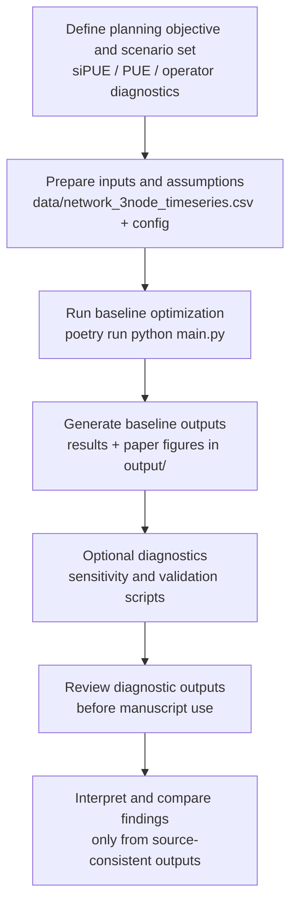
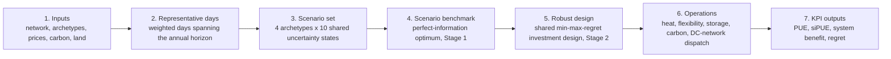

# sipue_modelling

Modeling code, experiment outputs, and manuscript source for the paper:
**"Evaluating Data Centers as Assets in Local Energy Systems: A System-Integrated PUE Approach"**
by Sambeet Mishra, Ankana Singha, Khaled Aleikish, Thomas Øyvang, Dominic Stephen, and Rob Hovsapian.

## Contacts

- Sambeet Mishra, University of South-Eastern Norway: sambeet.mishra@usn.no
- Ankana Singha, Researcher, University of South-Eastern Norway: singha.ankana@usn.no

## Abstract

Data centers can export waste heat, provide demand flexibility, and use storage to relieve local grid stress, yet Power Usage Effectiveness (PUE) treats the electricity consumed by these services as overhead. We introduce System-Integrated PUE (siPUE), which subtracts a single delay-adjusted, energy-equivalent credit from the PUE numerator. The credit reflects the monetized system value of heat recovery, flexibility, peak relief, and avoided carbon damage from a jointly optimized design. When no services are active, the credit is zero and siPUE reduces exactly to PUE. We evaluate the metric using a two-stage design-and-operation model for four data-center archetypes across ten shared uncertainty states, with explicit treatment of heat, flexibility, land, and construction delay. In all 40 canonical scenarios, service-active designs increase PUE. By contrast, siPUE is lower than the services-disabled comparator in 36 of 40 baseline scenarios and 23 of 40 scenarios for the shared min-max-regret design. Weighted by annual IT energy, the baseline design increases average PUE from 1.17 to 1.24 while reducing siPUE to 1.14; the robust design increases PUE to 1.34 while reducing siPUE to 1.15. The robust design delivers 10.56 EUR/MWh IT of delay-adjusted system benefit, equivalent to about 19% of the reference electricity price. The reference price determines the magnitude of the credit, not its sign. Removing carbon damage from the ledger reverses the average improvement, indicating that both the magnitude and direction of the siPUE adjustment depend on the design objective and the assumed social cost of carbon. Internal property tests, held-out cases, and out-of-sample checks support the metric's internal consistency; external validation remains future work.

## Overview

This repository implements a two-stage optimization framework for data center integration with local energy systems and evaluates **System-Integrated PUE (siPUE)** alongside conventional PUE, integrated-planning accounting, and operator settlement diagnostics.

The core idea is to evaluate data centers not only as electricity loads, but as active system participants through:
- heat export to district heating,
- flexibility services,
- storage-enabled operation,
- and carbon, peak, network, heat, and flexibility effects in dispatch, integrated planning surplus, independent system cost, and validation outcomes.

## What This Repo Contains

- `brave/`: core modeling package (config, scenario generation, optimization, metrics, plotting, exports).
- `main.py`: thin compatibility entrypoint that re-exports public APIs from `brave`.
- `run_manuscript_sensitivity_repdays_annual.py`: manuscript sensitivity runner (heat price, flexibility price, cooling overhead, land availability, construction delay).
- `run_carbon_cap_relaxed_ablation.py`: carbon-cap diagnostic used to separate cap compliance from priced carbon-damage valuation.
- `run_out_of_sample_validation.py`: designs the robust portfolio on canonical states and evaluates it against freshly drawn synthetic scenarios.
- `run_train_test_scenario_validation.py`: held-out train/test diagnostic (design on states 1-7, evaluate on states 8-10), per archetype.
- `run_optimized_efficiency_comparator.py`: supplementary diagnostic where the services-disabled comparator chooses its own efficiency level freely, instead of the paper's design-matched 15% retrofit.
- `run_sipue_objective_comparison.py` / `run_sipue_objective_comparison_out_of_sample.py`: in-sample and out-of-sample comparison of the cost-regret Stage-2 objective against a direct siPUE-regret objective.
- `run_creative_figures.py`: regenerates the manuscript figure package from the existing CSV outputs, without re-running the optimization.
- `data/network_3node_timeseries.csv`: network and time-series input data.
- `output/`: generated results tables and paper figures (not tracked in git; regenerate locally via the scripts above).
- `tests/`: unit and integration-style tests plus golden references.
- `paper v3.tex` / `paper v3.pdf`: the tracked manuscript source and compiled PDF. The bibliography (`references.bib`) is generated/maintained locally and is not tracked in git, consistent with this repo's policy of excluding generated manuscript artifacts.

## Model outline

From the paper's abstract and Section 3 (Method):
- siPUE is defined to recover conventional PUE in the services-disabled comparator (no active services).
- siPUE uses a delay-adjusted independent avoided system cost, not private heat or flexibility revenue:
  `siPUE = [E_FAC - a_s * (C_ind,0 - C_ind) / p_ref]^+ / E_IT`.
- The availability factor `a_s` accounts for construction delay over the asset life, so longer delays reduce the credited system benefit.
- Heat, flexibility, carbon damage, peak capacity, transmission, and resource-cost effects enter siPUE through the independent system-cost ledger, not the private lifecycle market-cost objective.
- Private heat/flexibility revenues and ETS carbon-market payments remain in the market-cost objective and dispatch/profit diagnostics; they do not directly enter the siPUE numerator.
- Cooling electricity is included in facility load, PUE, and siPUE. The recoverable-heat source includes IT load and cooling heat, but the current formulation does not model a separate cooling-export service.
- A five-mode two-stage design is used: **identity** (sets the reference price and checks siPUE = PUE), **services-disabled comparator** (reference case), **baseline** (assumed incumbent service-active portfolio), **robust** (shared min-max-regret design per archetype across the ten uncertainty states), and **scenario-perfect** (per-scenario benchmark used only to compute regret).
- Carbon outcomes are reported through physical emissions, avoided-heat emissions, ETS market cost, and independent carbon-damage valuation, kept as separate ledgers so siPUE can be checked against physical and system-level diagnostics.
- The reference min-max-regret formulation is the design objective reported in the paper; the direct siPUE-regret objective is reported as a separate diagnostic (`run_sipue_objective_comparison*.py`).

## Setup and Run

### 1. Install dependencies

```bash
poetry install
```

### 2. Run base workflow

```bash
poetry run python main.py
```

The base workflow exports the paper-facing core cases: identity, services-disabled comparator, baseline, and the shared min-max-regret robust design. Heavier sensitivity, out-of-sample, carbon-cap, and objective-comparison diagnostics are kept as separate optional scripts.

### 3. Optional diagnostic sensitivity analysis

```bash
poetry run python run_manuscript_sensitivity_repdays_annual.py
```

This runner reports the manuscript sensitivity set with both labels and
numeric settings: heat price multiplier `0.30/0.90`, flexibility price
multiplier `0.125/0.375`, cooling overhead `0.8x/1.2x`, land availability
`0.65x/1.2x/100x`, and construction delay `0/12` months. Carbon-damage
valuation is kept as a separate policy ledger diagnostic, not a main
physical/market sensitivity factor.

### 4. Optional carbon-cap relaxed diagnostic

```bash
poetry run python run_carbon_cap_relaxed_ablation.py
```

This re-solves the baseline and two-stage robust design with the physical
carbon cap removed while keeping the carbon-damage price term active. The
output `output/congested3/carbon_cap_relaxed_ablation.csv` is used to check
whether the carbon-damage credit is driven by priced valuation or by cap
compliance.

### 5. Optional out-of-sample diagnostic

This designs the robust portfolio on the ten canonical states and evaluates the
fixed design under freshly drawn synthetic scenarios.

```bash
poetry run python run_out_of_sample_validation.py
```

### 6. Optional train/test scenario diagnostic

This designs the robust portfolio on uncertainty states 1-7 and evaluates the
fixed design on held-out states 8-10, per archetype.

```bash
poetry run python run_train_test_scenario_validation.py
```

### 7. Optional siPUE-regret objective comparison

```bash
poetry run python run_sipue_objective_comparison.py
poetry run python run_sipue_objective_comparison_out_of_sample.py
```

These compare the reference cost-regret Stage-2 objective against a direct
siPUE-regret objective, in-sample and on freshly drawn scenarios.

### 8. Regenerate manuscript figures only

```bash
poetry run python run_creative_figures.py
```

Rebuilds the figure package in `output/congested3/figures/` from the existing
CSV outputs, without re-running the optimization. Useful after a plotting-only
change (styling, labels, layout).

### 9. Run tests

```bash
poetry run pytest
```

## Repository workflow



## Model pipeline

This mirrors the two-stage design-and-operation model described in the paper
(Section 3, Figure 5): inputs are reduced to weighted representative days and
combined with the shared archetype x uncertainty-state scenario set;
scenario-perfect benchmarks are then used to formulate the shared
min-max-regret robust design, which is evaluated operationally and reported
through PUE, siPUE, system benefit, and regret.



## Paper and citation

The manuscript source (`paper v3.tex`) and compiled PDF (`paper v3.pdf`) are
tracked in this repository; the bibliography and generated figures are not
(see `.gitignore`). Please cite the paper above when using this code or its
outputs.

## Notes

- Python dependency management is configured via Poetry (`pyproject.toml`).
- Generated analysis artifacts are stored under `output/`.
