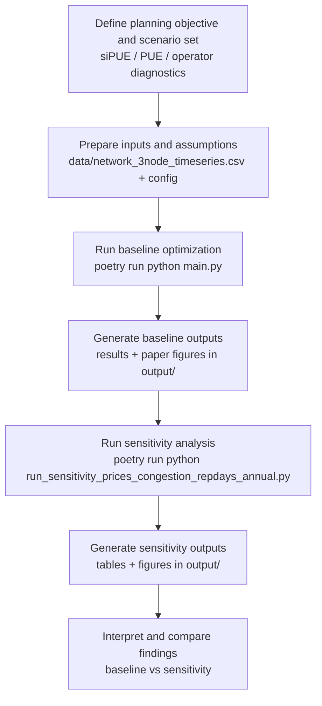

# sipue_modelling

Modeling code and experiment outputs for the paper:
**"Impact of Datacenter on Local Energy Systems - A business and economic perspective"**
by Sambeet Mishra, Ankana Singha, Khaled Aleikisha, Thomas Oyvang, Dominic Stephen, and Rob Hovsapianc.

## Overview

This repository implements a two-stage optimization framework for data center integration with local energy systems and evaluates **System-Integrated PUE (siPUE)** alongside conventional PUE, integrated-planning accounting, and operator settlement diagnostics.

The core idea is to evaluate data centers not only as electricity loads, but as active system participants through:
- heat export to district heating,
- flexibility services,
- storage-enabled operation,
- and carbon, peak, network, heat, and flexibility effects in dispatch, integrated planning surplus, independent system cost, and validation outcomes.

## What This Repo Contains

- `brave/`: core modeling package (config, scenario generation, optimization, metrics, plotting, exports).
- `main.py`: thin compatibility entrypoint that re-exports public APIs from `brave`.
- `run_sensitivity_prices_congestion_repdays_annual.py`: sensitivity-analysis runner.
- `data/network_3node_timeseries.csv`: network and time-series input data.
- `output/`: generated results tables and paper figures.
- `tests/`: unit and integration-style tests plus golden references.

## Model outline

From the referenced paper's abstract and setup:
- siPUE is defined to recover conventional PUE in the no-services counterfactual.
- siPUE uses delay-adjusted independent avoided system cost, not private heat or flexibility revenue:
  `siPUE = [E_FAC - a_s * (C_ind,0 - C_ind) / p_ref]^+ / E_IT`.
- The availability factor is `a_s = (1 - delta_global)(1 - delta_s)`, so construction delay reduces credited system benefit.
- Heat, flexibility, carbon damage, peak capacity, transmission, and resource-cost effects enter siPUE through the independent system-cost counterfactual.
- Private heat/flex revenues and carbon-market payments remain dispatch/profit and diagnostic outputs, but they do not directly enter the siPUE numerator.
- Cooling electricity is included in facility load, PUE, and siPUE. The recoverable heat source includes IT load and cooling heat, but the current formulation does not model a separate cooling export service or cooling-service revenue.
- Carbon market exposure is included in dispatch and profit through scenario or time-series CO2 prices.
- Carbon outcomes are also reported through emissions, CUE, carbon market cost, independent carbon damage, and independent system-cost outcomes so siPUE can be checked against physical and system-level diagnostics.
- Validation tables separate planning-objective alignment, external independent system-cost validity, incremental validity beyond PUE/ERE/CUE, and market/system-value diagnostics.
- A min-max regret formulation is reported as an integrated planning objective. Ex-post settlement fields remain available for audit/backward compatibility but are not used as manuscript diagnostics.
- In services-active scenarios, siPUE should be interpreted as a system-integrated metric based on the no-services independent system-cost counterfactual. Its primary external-validity target is normalized system benefit per MWh IT; absolute system benefit remains a scale/impact metric.
- Paper-facing tables should use compact labels such as `CO2 cost`, `DC CO2 share`, `DC CO2 change`, `carbon damage`, `system benefit`, `benefit per MWh IT`, and `delay factor`.

## Setup and Run

### 1. Install dependencies

```bash
poetry install
```

### 2. Run base workflow

```bash
poetry run python main.py
```

### 3. Run sensitivity analysis

```bash
poetry run python run_sensitivity_prices_congestion_repdays_annual.py
```

### 4. Run out-of-sample validation

This designs the robust portfolio on scenarios 1-5 and evaluates the fixed
design under held-out scenarios 6-10.

```bash
poetry run python run_out_of_sample_validation.py
```

### 5. Run cross-validated out-of-sample validation

This repeats the design/evaluation split across deterministic folds so every
scenario is evaluated once as unseen data.

```bash
poetry run python run_cross_validated_validation.py
```

### 6. Run tests

```bash
poetry run pytest
```

## Workflow



## Notes

- Python dependency management is configured via Poetry (`pyproject.toml`).
- Generated analysis artifacts are stored under `output/`.
